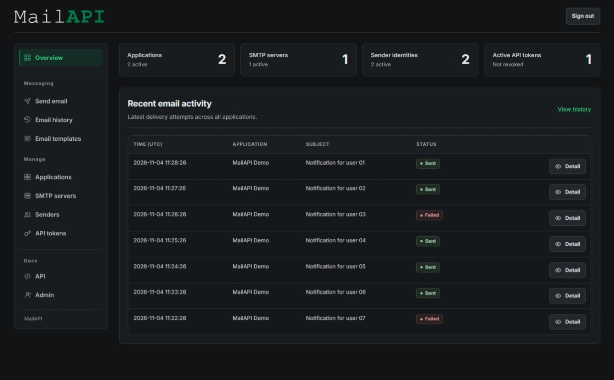

# MailAPI

MailAPI is a centralized PHP and MariaDB service for sending email through configured SMTP servers. Applications use bearer tokens with the `POST /send` REST endpoint, while the admin interface manages SMTP servers, senders, applications, tokens, reusable email templates, searchable delivery history, and manual email.



## Example

```sh
curl https://mail.example.com/send \
  -H "Authorization: Bearer YOUR_API_TOKEN" \
  -H "Content-Type: application/json" \
  -d '{"to":"recipient@example.com","subject":"Hello","body":"Sent with MailAPI"}'
```

Replace the URL with your MailAPI address and `YOUR_API_TOKEN` with an API token created for the application. This request sends a plain-text email; you can also provide `from` to select an allowed sender or use an application template with variables. Detailed API documentation, including request fields, template usage, and response examples, is available in the administration interface under **Docs → API**.

## Requirements

- PHP 8.0 or later with the required extensions.
- MariaDB
- Composer
- A PHP-capable web server

On Debian/Ubuntu, install the PHP required extensions with:

```sh
sudo apt update
sudo apt install php-cli php-common php-mysql
```

> **Note:** Composer is used to install dependencies but is not required on the hosting server if you upload the prepared `vendor/` directory.

## Installation

1. Upload the application to your server. Set the web root (document root) to the application directory containing `index.php`.
2. Install dependencies from the application directory:

   ```sh
   composer install --no-dev --optimize-autoloader
   ```

3. Create the database tables by importing [database/schema.sql](./database/schema.sql) into MariaDB. This file contains the complete application schema, including email templates; it does not create a database user or grant permissions. Give the application only the database access it needs. Import it only for a new installation; do not import it over an existing database.
4. Run the configuration generator from the command line:

   ```sh
   php bin/generate-config.php
   ```

   The generator prompts for a configuration path, database connection details, and an administrator password. By default, it creates `config.php` in the application root; you can change the path with the `MAIL_API_CONFIG` environment variable or enter a different path when prompted. It generates the password hash and a random encryption key. On Unix-like systems it sets file permissions to `0600`; on Windows, set an appropriate ACL. The generator will not overwrite an existing file.

   Back up the encryption key securely. Without it, stored SMTP passwords cannot be decrypted. If the key is lost or changed, re-enter the SMTP passwords.
5. Configure the web server to route requests for non-existent paths to `index.php` and block direct access to application source and configuration files. HTTPS is not enforced, but is strongly recommended in production to protect API tokens, email contents, and administration passwords in transit.

## Web server configuration

For Apache, enable `mod_rewrite` and allow `.htaccess` rules for the application directory. The supplied rules block access to source code, SQL files, dependencies, and the configuration template.

Nginx does not use `.htaccess`. Add equivalent rules to the site configuration (adjust `fastcgi_pass` for your PHP-FPM setup):

```nginx
location ~ ^/(src|database|vendor|bin)(/|$) { deny all; }
location ~* ^/(config\.php|config\.example\.php|composer\.(json|lock)|README\.md)$ { deny all; }
location / { try_files $uri $uri/ /index.php?$query_string; }
location ~ \.php$ {
    include fastcgi_params;
    fastcgi_param HTTP_AUTHORIZATION $http_authorization;
    fastcgi_param SCRIPT_FILENAME $document_root$fastcgi_script_name;
    fastcgi_pass unix:/run/php/php-fpm.sock;
}
```

The default `config.php` is in the application root, so direct web access must be blocked. The supplied Apache rules and the Nginx example block this path. If you choose another location, protect it equally.
